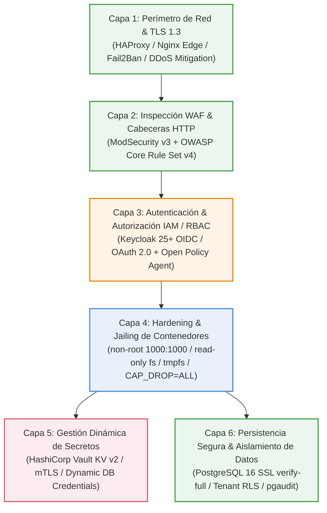

# GUÍA TÉCNICA: DEFENSA EN PROFUNDIDAD (6 CAPAS) Y MATRIZ RBAC
### *Estándar de Seguridad Empresarial para Sistemas Cloud-Native y Microservicios*

Este documento establece las especificaciones técnicas obligatorias de ciberseguridad, hardening de contenedores y control de acceso basado en roles (RBAC) que deben regir en todos los planos arquitectónicos producidos bajo la skill `software-architect-blueprint`.

---

## 1. DESGLOSE TÉCNICO DE LAS 6 CAPAS DE SEGURIDAD



---

### CAPA 1: PERÍMETRO DE RED Y TRANSPORTE CRIPTOGRÁFICO
El perímetro es la primera barrera frente al tráfico proveniente de redes no confiables (Internet). Su función es filtrar tráfico malicioso volumétrico y garantizar la confidencialidad e integridad del canal.

- **Protocolo Criptográfico:**
  - TLS 1.3 forzado como estándar primario. Permitir TLS 1.2 exclusivamente con suites de cifrado con secreto perfecto hacia adelante (PFS): `ECDHE-ECDSA-AES256-GCM-SHA384`, `ECDHE-RSA-AES256-GCM-SHA384`, `ECDHE-ECDSA-CHACHA20-POLY1305`.
  - Deshabilitar soporte para TLS 1.0, 1.1 y cualquier suite CBC o RC4.
  - HSTS forzado en todas las respuestas perimetrales:
    ```http
    Strict-Transport-Security: max-age=63072000; includeSubDomains; preload
    ```
- **Protección Perimetral Activa:**
  - **Rate Limiting:** Implementado mediante zonas de limitación en memoria (algoritmo Token Bucket o Leaky Bucket):
    - Tráfico general API: 50 req/s por IP con ráfaga máxima (*burst*) de 100.
    - Endpoints de autenticación (`/auth`, `/login`, `/token`): 5 req/s con burst de 10 para mitigar ataques de fuerza bruta y credential stuffing.
  - **Mitigación de Abusos:** Integración con Fail2Ban o CrowdSec dinámico inspeccionando logs en tiempo real para aplicar bloqueo temporal (iptables / nftables) tras 5 intentos fallidos consecutivos en una ventana de 2 minutos.

---

### CAPA 2: WAF (WEB APPLICATION FIREWALL) Y CABECERAS HTTP
Inspección profunda de peticiones HTTP/HTTPS (Capa 7) antes de ser enrutadas a la red de microservicios internos.

- **Motor WAF:** ModSecurity v3 compilado contra Nginx / Envoy con el conjunto de reglas estándar **OWASP Core Rule Set (CRS) v4**.
- **Modo de Operación:** Anomaly Scoring Mode con nivel de paranoia estricto (`paranoia_level=2`).
- **Amenazas Mitigadas Directamente:**
  - SQL Injection (SQLi)
  - Cross-Site Scripting (XSS) y DOM-based XSS
  - Remote Code Execution (RCE) y Command Injection
  - Local/Remote File Inclusion (LFI / RFI)
  - Path Traversal (`../../`)
  - Server-Side Request Forgery (SSRF)
  - XML External Entity (XXE)
- **Cabeceras HTTP Obligatorias de Protección del Navegador:**
  ```http
  Content-Security-Policy: default-src 'self'; script-src 'self'; style-src 'self' 'unsafe-inline'; img-src 'self' data: https:; font-src 'self'; connect-src 'self'; frame-ancestors 'none'; object-src 'none'; base-uri 'self'; form-action 'self';
  X-Frame-Options: DENY
  X-Content-Type-Options: nosniff
  Referrer-Policy: strict-origin-when-cross-origin
  Permissions-Policy: geolocation=(), camera=(), microphone=(), payment=(), usb=()
  X-Permitted-Cross-Domain-Policies: none
  ```

---

### CAPA 3: IDENTIDAD, AUTENTICACIÓN Y AUTORIZACIÓN (IAM / RBAC / OIDC)
El principio de Zero Trust exige que cada petición sea explícitamente autenticada y autorizada, sin asumir confianza por el simple hecho de encontrarse dentro de la red privada.

- **Proveedor Centralizado de Identidad:** Keycloak (v25+) desplegado en modo clúster sobre Quarkus, o IdP corporativo equivalente compatible con OpenID Connect (OIDC) y OAuth 2.0.
- **Ciclo de Vida y Firma de Tokens:**
  - **Access Tokens:** Formato JWT firmado asimétricamente mediante par de claves RS256 o ES256 (curva elíptica). Tiempo de vida máximo (*TTL*): **15 minutos**.
  - **Refresh Tokens:** Almacenados con rotación estricta (*Refresh Token Rotation*). Detección de reuso: si un refresh token revocado es presentado, toda la familia de tokens asociada a la sesión queda invalidada automáticamente.
  - **Validación Descentralizada:** Los microservicios backend validan los tokens de forma stateless utilizando el endpoint público JWKS (`/.well-known/jwks.json`) del IdP con caché local de claves en memoria (TTL 1 hora).
- **Motor de Políticas Granulares (RBAC / ABAC):**
  - Implementación desacoplada con **Open Policy Agent (OPA)** en modo sidecar o librería incrustada.
  - Las decisiones de autorización evalúan: identidad (`sub`), roles asignados (`roles`), identificador de inquilino (`tenant_id`), recurso solicitado y acción (`GET`, `POST`, `PUT`, `DELETE`).

---

### CAPA 4: HARDENING Y JAILING DE CONTENEDORES
Aislamiento a nivel de sistema operativo y kernel de Linux para evitar la fuga de contenedores (*container escape*) y mitigar movimientos laterales si un microservicio resulta comprometido.

#### Directivas Obligatorias en `docker-compose.yml`:
```yaml
services:
  api_backend:
    image: mycompany/api-backend:1.0.0
    restart: unless-stopped
    # 1. Ejecución con usuario sin privilegios (no-root)
    user: "1000:1000"
    
    # 2. Filesystem inmutable (solo lectura)
    read_only: true
    
    # 3. Directorios de escritura montados en memoria RAM efímera
    tmpfs:
      - /tmp:size=128M,noexec,nosuid,nodev
      - /app/.cache:size=64M,noexec,nosuid,nodev
      
    # 4. Eliminación de privilegios y escalada
    security_opt:
      - no-new-privileges:true
      - seccomp:default
      
    # 5. Descarte total de capacidades del kernel Linux
    cap_drop:
      - ALL
      
    # 6. Redes segmentadas mínimas indispensables
    networks:
      - backend_net
      - security_net
```

---

### CAPA 5: GESTIÓN DINÁMICA DE SECRETOS
Erradicación total de secretos estáticos. Las credenciales de acceso a bases de datos, llaves de API externas y certificados deben ser generados bajo demanda.

- **Gestor de Secretos:** HashiCorp Vault (v1.17+) configurado con almacenamiento persistente cifrado y motor **KV v2**.
- **Autenticación entre Servicios:** Cada microservicio se autentica contra Vault mediante AppRole o Service Account Token (en Kubernetes) usando canales TLS mutuo (mTLS).
- **Credenciales Dinámicas para Bases de Datos:**
  - Vault genera usuarios efímeros en PostgreSQL con privilegios mínimos y tiempo de expiración de 1 hora (*lease* con auto-renovación). Al terminar el lease o en caso de compromiso, Vault revoca la cuenta automáticamente en la base de datos sin requerir reinicio de la aplicación.
- **Prohibición de Archivos `.env`:** Queda terminantemente prohibido almacenar archivos `.env` en imágenes Docker o repositorios Git. Los secretos se inyectan en memoria RAM durante el inicio del proceso mediante Vault Agent o clientes API directos.

---

### CAPA 6: PERSISTENCIA SEGURA Y PROTECCIÓN DE DATOS
Protección de los datos en reposo y en tránsito, garantizando el aislamiento criptográfico y lógico entre inquilinos.

- **Cifrado en Tránsito:** Conexiones forzadas mediante SSL/TLS hacia los motores de bases de datos (`sslmode=verify-full`), validando el certificado de la CA interna.
- **Cifrado en Reposo:** Cifrado transparente a nivel de bloque en los volúmenes de almacenamiento mediante **AES-256-XTS** (LUKS / dm-crypt) o almacenamiento gestionado con claves administradas en KMS.
- **Aislamiento Multi-Inquilino con Row-Level Security (RLS):**
  - Cada tabla con información de usuarios o clientes implementa políticas RLS en PostgreSQL:
    ```sql
    ALTER TABLE orders ENABLE ROW LEVEL SECURITY;
    
    CREATE POLICY tenant_isolation_policy ON orders
      USING (tenant_id = current_setting('app.current_tenant_id', true)::uuid);
    ```
- **Auditoría Forense con `pgaudit`:**
  - Módulo `pgaudit` cargado en `postgresql.conf` para registrar operaciones DDL, cambios de permisos (`ROLE`), invocación de funciones privilegiadas y consultas a tablas de datos sensibles (cumplimiento PCI-DSS / HIPAA / ISO-27001).
- **Restricción de Red en Base de Datos:** Archivo `pg_hba.conf` configurado para admitir conexiones únicamente desde la subred interna `backend_net` descartando cualquier otra interfaz.

---

## 2. MATRIZ DE CONTROL DE ACCESO BASADA EN ROLES (RBAC)

Esta matriz define los privilegios granulares aplicados por el API Gateway y el motor OPA para los 4 roles principales de la organización:

| Rol | Alcance del Sistema | Método de Autenticación | Recursos & Permisos CRUD | Operaciones Prohibidas | Token TTL & Parámetros de Sesión | Nivel de Auditoría Forense |
| :--- | :--- | :--- | :--- | :--- | :--- | :--- |
| **`ADMIN`** *(SysAdmin / SecOps)* | Global (Multi-Tenant y Configuración de Infraestructura) | OIDC + MFA Obligatorio (TOTP / FIDO2 WebAuthn) | **Plataforma:** CRUD total.<br>**Usuarios:** Gestión de cuentas y roles.<br>**Políticas:** Definición de cuotas y reglas de seguridad.<br>**Logs:** Lectura de telemetría y eventos de seguridad. | **Datos de Negocio:** No tiene acceso de lectura a datos de clientes salvo con ticket de soporte auditado y aprobación dual (*four-eyes principle*). | **Access Token:** 15 min.<br>**Sesión:** 4 horas inactividad.<br>**IP Pinning:** Requerido. | **Máximo (CRITICAL):** Toda acción administrativa genera traza inmutable en Loki con firma criptográfica. |
| **`DOCENTE` / `EDITOR`** *(Gestor de Contenido / Tenant Manager)* | Específico de su Inquilino (`tenant_id`) | OIDC + MFA Recomendado | **Contenidos:** CRUD de cursos, archivos y asignaciones de su propio tenant.<br>**Calificaciones / Evaluaciones:** Lectura y edición de sus grupos.<br>**Reportes:** Lectura y exportación de métricas de su área. | **Usuarios:** No puede crear administradores ni alterar permisos de otros inquilinos.<br>**Infraestructura:** Sin acceso a configuraciones de red, Vault o logs del sistema. | **Access Token:** 15 min.<br>**Refresh Token:** 8 horas.<br>**Sesión concurrente:** Máximo 2 dispositivos. | **Medio-Alto (WARN):** Registro de creación, modificación o eliminación de contenidos y notas. |
| **`USUARIO`** *(Cliente / Estudiante / Empleado)* | Registro propio exclusivo (`user_id` / `tenant_id`) | OIDC (Password + Opcional TOTP) | **Perfil:** Lectura y actualización de datos personales propios.<br>**Contenidos:** Lectura de material asignado.<br>**Transacciones:** Creación de peticiones/órdenes propias. | **Acceso a datos ajenos:** Bloqueado a nivel API y validado en base de datos mediante RLS.<br>**Configuración:** Prohibido alterar cualquier metadato del sistema. | **Access Token:** 15 min.<br>**Refresh Token:** 24 horas con rotación.<br>**Detección de reuso:** Activa. | **Estándar (INFO):** Inicios de sesión, cambios de contraseña y transacciones monetarias o de estado. |
| **`AUDITOR`** *(Inspector de Cumplimiento / Compliance)* | Global de solo lectura (*Read-Only*) | OIDC + MFA Obligatorio | **Logs & Telemetría:** Lectura exhaustiva de registros `pgaudit`, eventos WAF, trazas de acceso Vault y métricas Prometheus.<br>**Configuración:** Inspección de políticas RBAC activas. | **Modificación:** Bloqueo absoluto de cualquier operación `POST`, `PUT`, `DELETE` o `PATCH` en toda la API. Solo verbos `GET` e `OPTIONS`. | **Access Token:** 15 min.<br>**Sesión:** 1 hora con cierre automático.<br>**Modo:** Read-Only Enforced. | **Alto (NOTICE):** Cada reporte exportado o consulta a los almacenes de auditoría queda a su vez registrada. |

---

## 3. CHECKLIST DE VERIFICACIÓN PREVIA AL DESPLIEGUE

Antes de certificar una arquitectura como "lista para producción", valida que cumpla cada uno de estos puntos:

- [ ] ¿El WAF es el único contenedor con puertos mapeados al host (`443:443`)?
- [ ] ¿Están declaradas las 5 subredes aisladas (`frontend_net`, `backend_net`, `security_net`, `media_net`, `observability_net`)?
- [ ] ¿Todos los contenedores tienen `user: "1000:1000"` y `read_only: true`?
- [ ] ¿Se eliminaron todos los archivos `.env` del repositorio y del empaquetado Docker?
- [ ] ¿Las tablas de base de datos implementan Row-Level Security (`ENABLE ROW LEVEL SECURITY`)?
- [ ] ¿El diagrama Terrastruct D2 compila sin errores utilizando el motor ELK (`d2 --layout=elk`)?
